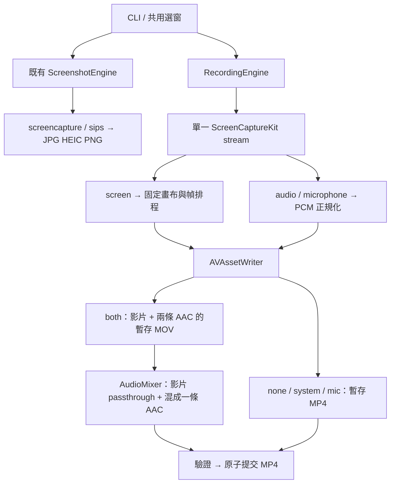

# Snapparazzi 錄影與音訊規格

狀態：提案，尚未實作。日期：2026-10-30。基準 commit：`6cb3de2a404730af77d794d8960b83a4d5ded1f3`。

使用者已確認：**新增錄影功能可以要求 macOS 15 以上；系統音訊以目標 App 為範圍**。其餘預設值是本提案的明確設計選擇，可在實作前調整。

實作順序見 [逐步實作計畫](../plans/2026-10-30-recording-implementation.md)；測試案例見 [驗證手冊](../plans/2026-10-30-recording-validation.md)。這次只新增設計文件，不變更程式、不發布版本。

## 1. 目標與邊界

- 保留所有既有截圖命令、互動流程、圖片格式與輸出目錄語意。
- 新增 `record`：指定一個視窗，錄製 MP4，可選無音訊、App 系統音訊、麥克風或兩者。
- 原生 Swift + ScreenCaptureKit + AVFoundation；不依賴 ffmpeg、虛擬音效卡或外部錄影程式。
- `both` 的最終 MP4 必須只有一條混音音軌，普通播放器可以同時聽到兩種來源。不能以「兩條可切換音軌」假裝完成混音。
- 第一版不含：全桌面／多視窗錄影、全機系統音訊、攝影機、串流、暫停／續錄、音量控制選項、裝置選擇、分段錄影、HDR、游標選項、聲音降噪／回音消除。
- `--duration 3600` 是必須驗證的使用情境；長時間錄製不得把整段影片或音訊累積在記憶體。

## 2. CLI 契約

```sh
# 舊命令完全保留
snapparazzi -w 12345 -i 2
snapparazzi --list

# 可選的明確截圖子命令，與省略子命令等價
snapparazzi capture -w 12345 -i 2

# 新命令
snapparazzi record --window 12345 --audio system --output recording.mp4
snapparazzi record --window 12345 --audio both --fps 30 --codec h264 \
  --duration 3600 --output recording.mp4
snapparazzi record --help
```

| record 選項 | 預設 | 合法值與行為 |
|---|---|---|
| `-w, --window` | 必填 | 正整數 UInt32 window ID；第一版 record 沒有互動選窗，缺少時 exit 2；先用既有 `--list` 查 ID |
| `--audio` | `none` | `none`, `system`, `mic`, `both`，大小寫固定，不另加別名 |
| `--fps` | `30` | 整數 1…60；目標輸出頻率，過載可掉幀，不允許補寫大量過期幀 |
| `--codec` | `h264` | `h264`, `hevc`；不把圖片格式 `heic` 當影片 codec |
| `--duration` | 無上限 | 有限十進位秒數，0.5…86400；計算錄影時間，不含授權、互動與收尾時間 |
| `-o, --output` | 自動檔名 | **MP4 檔案**，副檔名 `.mp4`（大小寫不敏感）；空值、其他副檔名 exit 2；實際存在目錄／檔案由 filesystem preflight 回報 exit 1 |
| `-m, --max-dimension` | 原始像素尺寸 | 正整數 2…8192；限制影片最長邊；不放大；實際編碼尺寸為偶數 |
| `-h, --help` | — | 印出錄影專用中英說明，不啟動 TCC、列視窗或建立輸出 |

預設錄影檔：`~/Snapparazzi/recordings/YYYYMMDD-HHMMSS-PID.mp4`。明確指定相對路徑時以目前工作目錄解析；支援 `~`、空白、中文路徑，不透過 shell 拼接。缺少的親目錄可建立；不能寫入或目標已存在時 exit 1。

命令解析規則：

1. 只有第一個 token 可以是 `capture` 或 `record`；其他情況走原有截圖解析器。未知位置參數仍是 exit 2。
2. `capture` 只去掉子命令後交給舊解析器。舊模式的 help/version 提前返回順序、`--test` 格式與錯誤碼不變。
3. `record` 使用獨立的 `RecordingOptions`，不能把 screenshot 的 interval/format 欄位塞入共用 options。
4. `record` 拒絕 `--interval`、`--format`、`--list`；截圖模式拒絕錄影專用選項。`record --version` 不新增為別名，版本使用根命令 `--version`。
5. 長短別名視為同一選項；重複、缺值、NaN、Infinity、溢位一律 exit 2。不得等到詢問權限後才報參數錯誤。
6. `record --help` 可提前返回，但前面已發現的錯誤不隱藏；例如 `record --fps bad --help` 為 exit 2，`record --help --fps bad` 印 help。
7. `--test arguments` 原有字串不變；新增 `--test record-arguments` 供無權限 CLI 測試，固定欄位順序。

建議 record 測試序列化：

```text
mode=record;window=42;audio=both;fps=30;codec=h264;duration=3600;output=recording.mp4;maxDimension=nil
```

未設定 duration 以 `nil` 表示，output 以 `default` 表示；錄影 parse 成功後 window 必須有值。不要依賴 locale 格式化數字。第一版要求明確 window，避免新增可取消互動輸入這個獨立功能；既有截圖互動選窗不變。

## 3. 平台、權限與聲音範圍

### 3.1 平台

- `record` 最低 macOS 15，使用 ScreenCaptureKit 的 microphone output，避免另接 AVAudioEngine 的跨時鐘錄音 fallback。
- 建置需 macOS 15 以上 SDK 與相容 Swift 工具鏈，可使用 Xcode 16 以上或對應 Command Line Tools；不強制安裝完整 Xcode。實際 Swift/SDK 版本在實作第一步記錄，API availability 用編譯器驗證。
- **不要把整個 executable 的 deployment target 直接提高到 macOS 15。** 舊截圖部署下限先由原始建置與 CI 確認；新類別以 `@available(macOS 15.0, *)` 隔離，入口 `if #available`。ScreenCaptureKit 對舊系統的 weak linking 必須驗證。
- 舊系統上 `record --help` 仍可用；真正錄影才回傳 exit 1 與最低系統版本提示。截圖／help／version 不得因載入新 framework 而啟動失敗。
- 若無法保持既有部署下限，先回報明確原因與變更提案，不可默默提高。

### 3.2 權限

| 模式 | 螢幕錄製權限 | 麥克風權限 |
|---|---|---|
| screenshot | 需要（沿用） | 不詢問 |
| record none / system | 需要 | 不詢問 |
| record mic / both | 需要 | 需要 |

CLI 二進位必須含 `NSMicrophoneUsageDescription`，採 `Resources/Info.plist` 嵌入 Mach-O 的 `__TEXT,__info_plist`。同時設定穩定的 bundle identifier、產品名、版本，開發版與安裝版走相同建置／簽章流程。不能只新增一份沒有被 binary 使用的 plist。

metadata 採單一來源：Info.plist 的 CFBundleShortVersionString 為版本原值；Makefile 產生 `.build/Generated/BuildMetadata.swift` 的版本常數，產品與測試建置皆納入此檔。產檔須為 dependency-driven、值有格式驗證、內容未變不反覆重寫；不要在 Swift 與 plist 各手動維護一個版本。初次仍為 1.1.0。

以 AVFoundation 檢查／請求 `.audio` 授權；拒絕、受限制、沒有可用麥克風或啟動失敗均 exit 1，不能自動降級成無聲錄影。系統設定中的授權對象可能是 Terminal、啟動它的 App 或 CLI 本身，需用乾淨安裝與更新後重測；不要保證只有 Terminal 需要授權，也不要要求繞過 TCC。不要求 Full Disk Access。

### 3.3 system 的定義

`system` 指 **ScreenCaptureKit 依目標視窗 filter 擷取的目標 App 音訊**，不是整台 Mac 的聲音，也不是麥克風。使用單一 `SCContentFilter(desktopIndependentWindow:)`；不得為了取得音訊，偷偷增加另一個全顯示器 stream。

限制必須在 help、README 與啟動摘要明說：**同一 App 其他視窗／分頁的聲音可能一起錄入，不能保證逐視窗隔離**。瀏覽器、多程序 App、DRM／受保護內容可能受系統限制；不能保證所有 App 都能擷取聲音。

實作前的實機 gate：目標 App 播音、另一個 App 播不同音，確認後者不出現在輸出；再測同 App 第二個視窗，記錄實際範圍。若選定 filter／OS 不能滿足 App 範圍，暫停 `system/both` 交付並修訂設計，不可把全機聲音當作等價替代。

`mic` 使用開始時的預設輸入裝置：取得預設 AVCaptureDevice 的 uniqueID，明確設定 SCK 的 microphoneCaptureDeviceID（確切 API 先由 probe 編譯確認）；不要留 nil 而意外跟隨 OS 預設變更。錄影期間不自動切裝置。選定裝置消失或格式無法重建為有效 stream 時以錯誤收尾，不繼續產生看似正常的無聲檔。none/system 不讀取或列舉麥克風。

## 4. 架構與責任

保留使用者提出的兩個獨立 engine，增加少量有明確責任的檔案：

```text
Sources/Snapparazzi/
├── main.swift                       # 唯一入口，啟動 async AppRunner
├── AppRunner.swift                  # action dispatch 與 exit code
├── CLI/
│   ├── CommandParser.swift
│   ├── Options.swift                # ScreenshotOptions / RecordingOptions
│   └── Help.swift
├── Core/
│   ├── WindowDiscovery.swift        # CGWindowID + ownerPID，共用選窗
│   ├── SessionManager.swift         # 截圖目錄／錄影檔案分開的方法
│   ├── StopController.swift         # 沿用截圖子程序取消語意
│   └── Permissions.swift
├── Capture/
│   └── ScreenshotEngine.swift       # 原 screencapture / sips 邏輯
├── Recording/
│   ├── RecordingEngine.swift        # 狀態機、一次性停止與總協調
│   ├── RecordingTypes.swift         # state/reason/result/stats/protocols
│   ├── ScreenStream.swift           # SCK filter/config/output/delegate
│   ├── AudioCapture.swift           # PCM 轉換、時間範圍裁切
│   ├── VideoWriter.swift            # 第一階段 AVAssetWriter
│   ├── AudioMixer.swift             # both 的離線混音與影片 passthrough
│   ├── FrameComposer.swift          # 固定畫布、縮放、黑畫面
│   └── RecordingTimeline.swift      # 共同原點、幀排程、截止時間
└── Testing/
    └── TestCommand.swift            # 原 --test 契約與新 parser probe
Resources/Info.plist
```

不要為了讓目錄好看就建立沒有工作的抽象。`AudioCapture` 不打開另一個裝置；麥克風輸入由同一個 `SCStream` 提供。



分層約束：parser 不存取 TCC／檔案／視窗；ScreenStream 不決定路徑；writer 不發 signal；engine 不做 codec 的底層 buffer 處理；所有元件以可注入 protocol 隔離真實 OS 服務與測試 fake。

## 5. 媒體資料契約

### 5.1 畫面

- 透過 window ID + owner PID 找到同一個 `SCWindow`；初始化時重新取 shareable content 確認，避免選窗後 App 已重開。
- 只接收合法、有效且 `SCFrameStatus.complete` 的 screen sample；狀態附件缺少／不合法不得當作完整畫面。
- SDR、BGRA 輸入；影片 h264 或 hevc；不做 HDR。設定 frame interval `CMTime(value: 1, timescale: fps)`、`showsCursor = false`、有限 queue depth（起始 3）。
- 以所選視窗的實際 backing pixels 決定起始大小，不可把 points 直接當 pixels；Retina／外接螢幕的 scale 取得方式在技術驗證先確認。
- 令原始尺寸 `w,h`，`s = min(1, maxDimension / max(w,h))`（沒有設定則 s=1），`W=2*floor(w*s/2)`、`H=2*floor(h*s/2)`；任一結果小於 2 或 codec 不支援尺寸則明確失敗。未設定 maxDimension 的超大視窗不偷偷縮小或切換 codec，提示使用 `-m`。
- 輸出畫布 W×H 在整個 session 固定；視窗縮放、移動到不同 DPI 螢幕後，依當前內容等比例縮放置中、黑邊補齊，不拉伸、不放大內容、不重新建立 writer。
- source stream 的配置與 writer 畫布分開：先由 probe 確認 SCK frame attachments 的 contentRect/scale 語意，裁出真正內容；必要時更新 SCStreamConfiguration 的來源尺寸以維持當前視窗比例。不能讓 SCK 先把新比例拉伸成舊 W×H，再宣稱 FrameComposer 可以還原；writer W×H 始終不變。
- 使用一個可重用 `CIContext` 與有限 `CVPixelBufferPool`，不能每幀重新建立 heavyweight context 或 pool；限制 outstanding pixel buffers。
- 排程器在相同畫面／idle 時重用最近畫面，維持目標 fps。負載過高只跳過已過期的幀槽，計數並保留實際時間，不能靠重新連續編號把影片加速。
- 判定目標視窗暫時不可見（最小化／其他 Space）後，最多保留最後畫面 1 秒，接著輸出固定大小黑畫面，audio 繼續；恢復後續錄同 ID + PID。不要以「沒有新畫面 callback」判定 unavailable，靜態視窗也可能是 idle。
- 視窗確定關閉、owner PID 消失、stream fatal error：停止並保留可完成的片段，exit 1；不自動挑另一個視窗。CG 全視窗資訊與可見視窗資訊分開判斷，不能把 minimize 當 close。

### 5.2 音訊

| 模式 | SCK 設定／輸入 | 第一階段 | 最終檔 |
|---|---|---|---|
| none | 不啟用 audio/mic | MP4：1 video | 1 video、0 audio |
| system | capturesAudio；`.audio` | MP4：1 video + 1 AAC | 1 video、1 AAC |
| mic | captureMicrophone；`.microphone` | MP4：1 video + 1 AAC | 1 video、1 AAC |
| both | 兩者啟用 | MOV：1 video + 2 AAC | MP4：1 video、1 mixed AAC |

- 系統音訊請求 48 kHz stereo；不能假設麥克風也服從該設定。讀實際 ASBD，對 mono/stereo、44.1/48 kHz 使用每來源獨立且持續存在的 AVAudioConverter，正規化為 48 kHz、2 channels PCM。
- 每個來源有自己的 converter 與 sample cursor；跨 buffer 的小數取樣誤差須保留，不要每塊獨立四捨五入而累積漂移。裝置／格式改變必須有已測的重建或明確失敗策略。
- 先用 source PTS 偵測缺口／重疊，再送 converter。缺口時 drain 前段有效尾端、reset converter、按新的 source PTS 重新定位，缺口由共同時間軸補零；重疊先裁掉重複的 input frames。不能把不連續 input 直接拼接後偽造連續 PTS。格式改變同樣 drain/reset/re-anchor，重建失敗明確報錯。
- 實際順序為：有界 raw audio reorder queue → 依 PTS 取到 watermark 為止 → 偵測連續性／轉換 PCM → 對齊共同時間軸／補零 → writer。不能先把逆序 raw buffers 餵 converter，再於轉換後才排序；reorder 與轉換後 pending 共用每來源的總容量預算。
- 最終音訊 AAC-LC、48 kHz stereo、192 kbit/s。第一階段 both 兩條 AAC 同規格；經第二次音訊編碼的品質折損是本版取捨，影片不重編碼。
- both 的混音為 `system * 0.5 + mic * 0.5`，兩來源保留左右聲道；缺某來源的時間區間視為零。避免相加爆音，單一模式維持 gain 1.0。
- 合法的零振幅 PCM 是安靜，不是錯誤。已授權且 stream 成功時，資料間隙可以補零；初始化權限／裝置錯誤不能被補零掩蓋。摘要記錄實際 buffer 數、補零秒數與掉資料量，完全沒有音訊資料要警告，不能宣稱驗證了「有聲」。
- 補零產生器獨立於 converter，固定輸出 48k stereo PCM；即使某來源完全沒有 callback，也能在既有合法 stream／permission 狀態下寫出正確時間長度的靜音軌，不等待第一個 buffer 才定義靜音格式。
- 第一版沒有 acoustic echo cancellation。外放聲音被麥克風再收一次會有回音；同錄兩來源建議戴耳機。

### 5.3 共同時間軸（不可省略）

1. 技術驗證先確認 `.screen/.audio/.microphone` 的 PTS 時鐘與 host clock 的關係。不能用 callback 抵達順序或 `Date()` 代替媒體 PTS。
2. 第一個完整 video frame 的 source PTS 為 `t0`。所有來源都以 `sourcePTS - t0` 定位，**不可以各自第一個 sample 歸零**。第一幀寫在 0。
3. t0 前的 audio 丟棄或以 sample 精度切掉跨界前段；開始前等待第一幀的暫存只容許固定上限（250 ms audio），超過丟棄，啟動後 5 秒無完整 video 回報錯誤。
4. video ticker 根據與 t0 同域的單調 host clock 選擇 `n/fps` 幀槽；以最近不晚於該槽的合法畫面產生 frame。正常負載下靜態畫面仍持續輸出；不能每收到一張畫面就自行加 `1/fps`。
5. audio 使用有理數 CMTime、48k sample cursor 與共同 t0。對每來源的重疊樣本裁掉重疊部分；重複／逆序 buffer 計數，不能讓 writer 接受倒退時間。
6. 音訊補零以固定 250 ms reorder window 的 watermark 為界；watermark = `max(0, 已換算到共同媒體軸的 hostNow - 250ms)`，不得依賴最新 audio callback 才前進。watermark 以前才確認缺口並補零。buffer 比已提交 cursor 還早的部分不能補寫；持續發生要以 pipeline overloaded 錯誤收尾，不能無限延遲或偷改音高。停止且來源封閉後，watermark 直接推到精確 endpoint 並 drain。
7. duration 模式的媒體終點是 D；手動停止為 `hostStop - t0`。只寫入終點以前的影像，PCM 以 sample 精度裁切，`endSession` 使用同一終點，避免 AAC 尾包把影片延長到失控。
8. 跑完音訊 converter 的有效尾端、補足必要靜音／最後畫面後才能 mark input finished。啟動前停止、沒有任何完整 video 時不產生正常 MP4。
9. both 的混音／remux 必須保留原始 track start offset、PTS、DTS 與 video transform；禁止把延遲開始的 mic 移到 0。

這些規則須由合成 sample 測試與實機同步測試證明，不能只測檔案存在。

## 6. both 的兩階段處理

第一階段用 AVAssetWriter 寫 MOV，分開保存 video、system AAC、mic AAC。停止後先完成 MOV，再混音成 MP4。這比第一版就寫即時多來源 mixer 更容易測試與定位錯誤，代價是停止後仍需處理時間與額外磁碟。

第二階段的指定方案：

1. 使用現代 async `AVAsset.load` APIs 讀 stage asset、tracks 與 format descriptions，避免 warnings-as-errors 下使用已棄用同步屬性。
2. video 用 `AVAssetReaderTrackOutput(outputSettings: nil)` 讀壓縮 sample；MP4 的 video input 用 `outputSettings: nil` 與正確 `sourceFormatHint`，原樣轉封裝，保留 sample 的 PTS/DTS、讀出順序及 preferredTransform。
3. audio 用 `AVAssetReaderAudioMixOutput` 同時讀兩條原始 tracks，設定 `AVMutableAudioMix` 每條 gain=0.5，輸出 48k stereo PCM，再寫入單一 AAC input。以原 asset 的 track offsets 混合，不把每條 track 的開頭移到零。
4. 離線 writer 的 `expectsMediaDataInRealTime=false`；每個 input 使用 readiness-driven pump，讀取／寫入有限 buffer。不能先把全部影片讀進陣列，或忙等 writer readiness。
5. reader 完成且兩輸出 EOF、所有 append 成功、writer finish completed 後才做成品檢查與提交。音軌為全靜音時也須符合輸出 track 契約。

**不用 AVAssetExportSession passthrough + audioMix 當捷徑**：passthrough preset 不提供所需音訊混合；換其他 preset 可能重編影片、改 codec／尺寸。以上 passthrough 路線須先用 H.264、HEVC fixtures 證明；若 SDK／容器不支援，回來更新設計與成本，不能默默重編碼。

磁碟估算以 video target bitrate 起始值 `clamp(W*H*fps*0.12, 2_000_000, 40_000_000)` bit/s，加上每條音軌 192000 bit/s；這是預算，不是保證的實際大小。duration 已知時，預檢至少 `預估第一階段大小 * 2.2 + 512 MiB` 可用空間；未知時起始 1 GiB，持續監控低水位 512 MiB。可用空間查不到則警告，writer ENOSPC 仍是必要處理。

both 收尾期間 stage 與最終暫存檔會同時存在，記憶體必須保持有界；進度訊息用「正在混音／完成檔案」而不是繼續顯示錄影。**不能承諾 duration 3600 的命令在 3600 秒時就返回**。最終收尾速度以實測回報。

## 7. 執行緒、背壓與狀態機

```text
idle → preparing → starting → recording → stopping → finalizing → completed
                            ↘                ↘          ↘
                                     failed
```

- engine 的狀態與終止原因由單一序列協調器管理；writer 的所有 calls 由單一 media queue 管理。SDK callback 不直接修改跨 queue 的狀態。
- SCK video/system/mic callback queues 與 media queue 分開；傳遞 buffer 前先取得有界容量，不能每個 sample 無限 `Task {}` / `async`。
- 原始 video 只保留最新兩張；audio 待處理總量每來源最多 1 秒（包含最多 250 ms reorder，預留 callback／converter 的 chunk 空間）。容量不足：video 丟幀並記數；audio 超過硬容量即以錯誤收尾，不丟棄後繼續假裝成功。即使尚未達硬容量，writer 連續 1 秒不 ready 也視為過載；時間使用單調 host clock。
- 畫面轉換與 writer input 不 ready 時也適用容量限制；第一階段 inputs `expectsMediaDataInRealTime=true`。每次 append 檢查 Bool 與 writer.status/error。
- signal 用 DispatchSource（SIGINT、SIGTERM），handler 只送停止請求；不能直接 `exit()` 或在 POSIX signal handler 中呼叫 AVFoundation。
- `requestStop(reason)` 冪等；duration、signal、stream error 同時發生只停止／finish 一次。正常原因後收到 runtime failure 必須升級錯誤，不能被成功原因蓋過。
- 截圖原 `StopController` 保留 Process interrupt 功能；錄影不能把 `Process.interrupt()` 當 SCK 的停止實作。
- 停止順序：建立 endpoint、停止 ticker/監控 → await stopCapture（或處理停止錯誤），這段期間仍有界接收 endpoint 以前的 in-flight samples → 以 callback barrier 封閉來源 → drain 有界佇列／converter／時間軸尾端，補至 endpoint → mark inputs finished → await finishWriting → both 混音 → 驗證 → commit。
- 只有「來源已封閉」之後的晚到 callback 才忽略且安全釋放；不能一進 stopping 就丟掉尚在路上的尾端音訊。禁止在 writer queue 內同步等待同一 queue 的工作。失敗路徑同樣需解除 delegate、取消 timer、恢復 signal disposition。
- 第二次 SIGINT 在一般停止期間仍維持冪等；both 離線混音時可取消，保留 stage 並 exit 1。SIGKILL／斷電不保證可播放 MP4。

## 8. 檔案與錯誤契約

- `SessionManager` 使用輸出同一檔案系統的私有 staging directory（0700），檔案 0600 或更嚴；不得改使用者的既有檔案。
- 參數及 OS gate 後先做無副作用的 output preflight（現有目標、路徑型別、可知的父目錄權限），再請求 TCC。真正建立親目錄／stage 在權限與選窗成功之後，且重查競態；必要時此時仍可能因路徑變更失敗。
- first stage、mixed candidate、最終檔分開命名。目標存在一律拒絕，v1 不加 `--force`。提交時也必須原子「不覆蓋」：macOS `renamex_np(..., RENAME_EXCL)` 或等效且有 race 測試的實作；`fileExists` 後普通 rename 仍可能覆寫，不合格。
- 使用者看到最終路徑時，檔案必須已經完成 AVAssetWriter 並可讀，有至少一張可解碼畫面、正確 track 數、codec、尺寸、正 duration。不能把空檔案 rename 當成功。
- 成品 runtime preflight 讀 metadata 與至少首／尾可解碼 sample，不再完整重播一小時影片才返回；測試檢查器才做完整解碼。無法完成檢查視為失敗，保留 candidate。
- none/system/mic writer 失敗：關閉資源，保留 stage 路徑並標示可能不完整，exit 1；沒有有效內容的空 stage 清理。both 已完成 MOV 卻混音失敗／被取消：保留 MOV，明確告知它有兩條獨立音軌、尚非完成混音的 MP4。
- 成功只留下最終 MP4，移除自己建立的 staging；不能掃描或清理其他 session。啟動前授權／參數失敗不留錄影檔。
- Ctrl-C／SIGTERM／duration 正常完成且有有效影片：exit 0；參數錯誤 exit 2；runtime、window closed、音訊裝置、容量、append／finalize／commit 失敗 exit 1。
- 截圖使用者取消選窗仍 exit 0；錄影沒有互動選窗。record 啟動 stream 後 5 秒沒有完整畫面 exit 1；尚無影像就收到停止，不產正常 MP4，exit 0 並說明「取消，沒有錄到畫面」。signal sources 在 preparing 起生效，權限 dialog 等待期間可取消，不直接 exit 破壞已建立媒體。
- 診斷包含 stage（permission/stream/writer/mix/commit）、OS error、window ID/PID、已錄秒數、stage 保留位置；不得記錄麥克風內容或不必要的視窗文字。

摘要至少列出：最終／保留檔路徑、錄影時間與收尾時間、尺寸、codec、audio mode、寫入／掉落幀數、每來源 buffer／補零時間、停止原因。正常可見輸出使用中英說明，錯誤寫 stderr。

## 9. 建置、發行與驗證要求

現況 `main.swift` 934 行；Makefile 只編譯它；`install.sh` 只下載它；curl fixture 也只複製它。**拆檔、Makefile、完整來源安裝器與 installer tests 必須同一個可驗收里程碑完成。**

- 保留直接 `swiftc` 建置，不因新增功能引入套件依賴。Makefile 掃描所有 production `.swift`，新增／修改任一檔及 Info.plist 都需重編，flags／部署設定改變也不能誤用舊 binary。
- installer 下載同一 ref 的完整 GitHub source archive；包含 Sources、Resources、Makefile，與本地走相同編譯／簽章。保留 SNAPPARAZZI_REF、SNAPPARAZZI_BIN、原子安裝、失敗不傷舊 binary、清理暫存、PATH 設定。
- Info.plist 必須在 code signing 之前嵌入。開發版與 installer 版使用同一穩定 identifier；ad-hoc 簽章不保證每次重建都保留 TCC，須實測並文件化。沒有需要時不擅自加入 hardened runtime／sandbox entitlements。
- 初期重構維持版本 1.1.0；錄影功能完成並驗收後才單獨討論版本調整。這份計畫不授權 push、tag、合併或 release。
- 一般 CI：保留既有 53 項 CLI 測試、7 項 installer 測試（使用者已回報在 Mac 全部通過，環境與證據範圍見驗證手冊），新增 parser、狀態機、時間軸、synthetic media 與 installer tests；不得依賴視窗／TCC 才能跑完。
- 真實錄影／音訊／TCC 使用獨立的 opt-in Mac 驗證，不可因 CI 沒 GUI 就假裝功能測試通過。
- Linux 只用於編輯／Shell 語法與文件檢查；本提案沒有在 Linux 編譯、錄影或驗證 Apple APIs。

## 10. 技術驗證的必須完成項

目前雲端 proxy 連線不可用，本輪無法即時讀 Apple 文件，也沒有 macOS SDK。以下連結是供實作者查閱的官方參考，**不是已在本環境驗證過的 API 範例**。第一個實作 task 必須在實機編譯小型 probe，核對 signature、availability、deprecated APIs 與實際行為後再開工。

- [ScreenCaptureKit](https://developer.apple.com/documentation/screencapturekit)：SCShareableContent、SCContentFilter、SCStream、SCStreamConfiguration、SCStreamOutputType.microphone。
- [Capturing screen content in macOS](https://developer.apple.com/documentation/screencapturekit/capturing-screen-content-in-macos)：filter、sample callback、frame status。
- [AVAssetWriter](https://developer.apple.com/documentation/avfoundation/avassetwriter)：實時 inputs、session、finish、compressed passthrough。
- [AVAssetReaderAudioMixOutput](https://developer.apple.com/documentation/avfoundation/avassetreaderaudiomixoutput)：多來源混音與 PCM 輸出。
- [AVAudioConverter](https://developer.apple.com/documentation/avfaudio/avaudioconverter)：連續 PCM 轉換與 drain。
- [NSMicrophoneUsageDescription](https://developer.apple.com/documentation/bundleresources/information-property-list/nsmicrophoneusagedescription)：CLI 麥克風用途描述。

Gate 未通過的功能不能標成已完成：App 音訊範圍、共同時鐘、麥克風 CLI 授權、舊系統啟動、H.264/HEVC 混音後 passthrough、Retina 像素與 resize、視窗 minimize／close 的區別。
